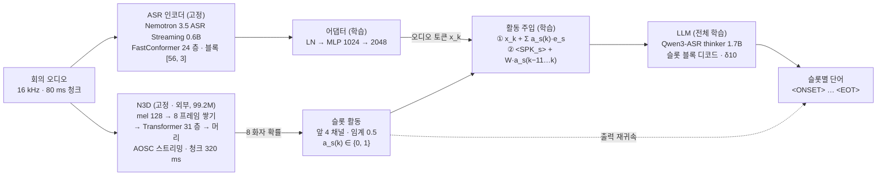
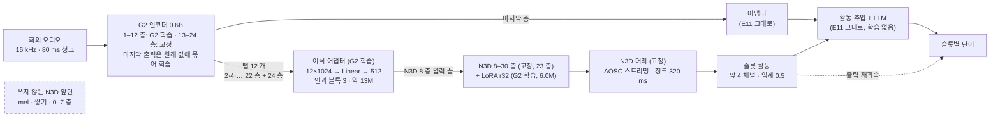

# E11·G3 모델 구조 (2026-11-02)

- 요청: 사용자 "G3와 E11 에 대한 모델 구조 설명을 그림과 함께 작성해줘."
- 그림 페이지(비공개 — 공유는 페이지의 Share 메뉴): https://claude.ai/artifact/GEYEpKf8DoeyxrH8LVxczS
- 한 줄: 두 모델은 받아쓰는 LLM 이 같고, 화자 활동의 출처가 다르다.
  - E11 은 외부 화자 분리기 Nemotron 3 Diarization(N3D)을 그대로 붙인다.
  - G3 는 그 자리에 G2 학생(우리 인코더 층 출력 위에 N3D 위층을 이식)을 넣는다. 음향 인코더가 하나다. E11 을 다시 학습하지 않은 평가판이다.
- 근거: E11 config(`/soundai/Model/VAPASR/stage3-q17-e11/final/config.json`), G2 graft.json(`/soundai/Model/VAPASR/graft-q17-graft-g2-lora/final/graft.json`), 코드 `vapasr/hf/modeling_vapasr.py`·`n3d.py`·`n3d_graft.py`·`long_session.py`.

## 1. 공통 — 슬롯 블록으로 받아쓰는 LLM
- 오디오는 80 ms 마다 오디오 토큰 하나가 된다.
- 청크마다 선언 슬롯 태그 `<SPK_A>`…`<SPK_D>` 를 정해진 입력으로 넣는다(C·D 의 실제 이름은 `<SPK_3>`·`<SPK_4>`).
  - LLM 은 태그를 고르지 않는다. 슬롯마다 이번 청크에 낼 것만 낸다: 말 시작 `<ONSET>`, 단어, 말 끝 `<EOT>`.
  - 그 슬롯을 마칠 때 `<NEXT_AUDIO>` 를 예측한다. 위치를 따로 차지하지 않는다.
- 단어는 그 소리보다 δ 청크 늦게 낸다(학습 4–10, 평가 10 = 0.8 s, 평균 지연 0.92 s). 선언 슬롯 수와 δ 는 프롬프트 앞머리에 준다.
- 화자 활동 a_s(k) 는 두 곳에 더한다.
  - ① 오디오 토큰 += Σ_s a_s(k)·e_s (Linear 4 → 2048, 바이어스 없음)
  - ② 슬롯 태그 임베딩 += W·[a_s(k), …, a_s(k − 11)] (Linear 12 → 2048, 바이어스 없음)

```
청크 k  : [오디오 x_k] [<SPK_A>] (<ONSET>) (so) ■ [<SPK_B>] ■ [<SPK_C>] (yeah) (<EOT>) ■ [<SPK_D>] ■
청크 k+1: [오디오 x_k+1] [<SPK_A>] (the) …
[ ] 정해진 입력   ( ) LLM 출력   ■ <NEXT_AUDIO> 예측(이 슬롯은 이번 청크 끝)
'so' 의 소리는 청크 k − 10 에 들어왔다(δ = 10).
```

## 2. E11 — 외부 화자 분리기(N3D)를 붙인 모델



| 부분 | 구성 | 크기 | E11 학습 |
|---|---|---:|---|
| ASR 인코더 | Nemotron 3.5 ASR Streaming 0.6B. FastConformer 24 층, 80 ms 프레임, 블록 스트리밍 [56, 3](왼쪽 4.48 s, 미리보기 240 ms, 블록 320 ms) | 0.6B | 고정 |
| 어댑터 | LN → Linear 1024→2048 → GELU → Linear 2048→2048 | 6.3M | 학습 |
| 화자 분리기 N3D | mel 128 → 8 프레임 쌓기 → Transformer 31 층(d 512, RoPE) → 머리. 10 ms 확률을 80 ms 로 평균, 8 화자 도착 순서. AOSC 캐시 264 · FIFO 264 · 주기 222, 추론 청크 4(320 ms — 인코더 블록 경계, 지연 더하지 않음) | 99.2M | 고정, 체크포인트 밖 |
| 슬롯 활동 | 앞 4 채널(도착 순서 = 슬롯 순서)을 임계 0.5 로 0/1 | – | – |
| 활동 주입 ①·② | 위 1 절 | 8K·25K | 학습 |
| LLM | Qwen3-ASR 1.7B 의 thinker(오디오 타워 제거), 숨은 차원 2048 | 1.7B | 전체 학습 |

- 학습: E9 final 에서 5,000 step, 받아쓰기 과제만, 인코더 고정.
  - 활동 입력은 표본마다 확률 ρ 로 N3D 활동(학습 청크 16 = 1.28 s), 아니면 흔든 정답 활동이다.
  - N3D 채널 순서는 학습 때 정답 슬롯 자리에 맞춘다(`align_slots`). 추론은 채널 k = 슬롯 k 다.
  - 선언 슬롯 수는 학습 창마다 [창 화자 수, 4] 에서 뽑는다.
  - E9 에서 온 자체 화자 분리 헤드(인코더 탭 위 12 층)는 체크포인트·손실에 남아 있지만 E11 의 활동 입력으로는 쓰지 않는다.
- 회의 통째 디코드(`long_session`)
  - 인코더는 384 s 조각(앞 겹침 141 s)으로 나눠도 스트리밍 값과 같다(차이 1e-6 수준).
  - N3D 는 회의 전체를 한 번 스트리밍한다. 화자 캐시가 회의 내내 이어진다.
  - LLM 은 최근 30 s 문맥으로 디코드한다. 청크마다 [오디오, 태그 D 개]를 한 번에 넣고 낼 것이 있는 슬롯만 한 토큰씩 낸다.
- 출력 재귀속(학습 없음): 단어의 오디오 프레임 f = 방출 청크 − δ. 창 [f − 3, f + 1] 에서 LLM 슬롯이 꺼져 있고 다른 슬롯만 켜져 있으면 활동이 가장 많은 슬롯으로 옮긴다. 이미 있는 활동만 써서 지연이 늘지 않는다.
- N3D 를 하위 모듈로 옮긴 흡수판(체크포인트 하나)도 있고 출력은 E11 과 같다([[output-diarizer-replacement-20261031]] 8.2 절).

## 3. G3 — N3D 자리에 G2 학생, 인코더 하나



- 인코더 층 출력(탭)이 받아쓰기와 화자 분리에 함께 쓰인다. 탭은 0 부터 세면 1, 3, …, 21 층과 마지막 층이다(E9 자체 헤드와 같은 홀수 층).
- G2 학생의 구성(`GraftExpert`)
  - 이식 어댑터: Linear 12,288 → 512 뒤에 인과 블록 3 개(LN → 깊이별 conv, 왼쪽만 커널 5 → 점별 Linear; LN → FFN 2048). 약 13M(설정으로 셈). 출력은 N3D 8 층 입력 꼴이다(7 층 출력 잔차 흐름).
  - N3D 위층: 8–30 층 23 개(d 512). 원 가중치 고정, 층마다 Linear 넷(attn w_qkv · out_proj, FFN 둘)에 LoRA(r 32, α 32), 학습 6.03M.
  - 머리와 스트리밍: N3D 머리 고정, AOSC 설정은 E11 과 같다(청크 4, 캐시 264, FIFO 264, 주기 222). 캐시 무음 자리는 학습 데이터에서 교사가 무음으로 본 프레임의 8 층 입력 평균이다.
- G2 학습(학생만 — G3 자체는 학습 없음)
  - 계보: G1b(이식 어댑터만, 스트리밍 증류) → U3(+ 인코더 아래 12 층) → G2(+ N3D 위층 LoRA, 정답 PIT).
  - U3 final 에서 2,000 step, 60–90 s 창, 학습 스트리밍 청크 16(1.28 s). 학습률: 이식 어댑터 5e-5, 인코더 아래 12 층 2e-5, LoRA 1e-4.
  - 손실: 교사 N3D 스트리밍 확률 증류 1.0 + 정답 Sort·PIT 0.5 + 8 층 입력 MSE 0.1 + ASR 지킴 10(인코더 마지막 출력을 원래 값에).
  - 데이터: 우리 학습 코퍼스(한국어 대화, AMI · ICSI · NOTSOFAR · CHiME-6 근·원거리, 합성 회의)와 잡음·잔향 증강.
- 지금 평가 구현(`cst_stage3_eval --graft-expert`)은 학생 탭을 같은 인코더 가중치로 한 번 더 계산한다(두 번째 forward). 한 forward 로 묶기는 남은 일이다([[output-diarizer-replacement-20261031]] 10 절).

## 4. 차이

| 항목 | E11 | G3 |
|---|---|---|
| 받아쓰기 인코더 | 원 Nemotron 0.6B(고정) | G2 인코더(아래 12 층을 화자 분리와 함께 학습, 마지막 출력은 원래 값에 묶음) |
| 화자 활동 출처 | N3D 전체(자기 mel → 쌓기 → 31 층 → 머리) | G2 학생(탭 12 개 → 이식 어댑터 → N3D 8–30 층 + LoRA → 머리) |
| 화자 분리 입력 | 오디오(N3D 자신의 mel) | 우리 인코더의 층 출력 |
| 음향 인코더 | 둘 | 하나(N3D 앞단 없음) |
| 저장 | N3D 는 체크포인트 밖(흡수판은 안) | graft.pt(이식 어댑터 · LoRA · 인코더) |
| 스트리밍 | 청크 320 ms, AOSC 264 · 264 · 222 | 같음 |
| 어댑터 · 활동 주입 · LLM | E11 학습 결과 | E11 그대로 |
| 출력 재귀속의 활동 | N3D 활동 | 학생 활동 |
| 지연 | 평균 0.92 s | 같음(지금은 탭을 한 번 더 계산해 계산량만 는다) |

## 5. 결과 요약 (AMI eval, 회의 통째, IHM-mix / SDM)

| 판 | cpWER | + 출력 재귀속 | 받아쓰기 agn | 활동 어김 | 화자 분리 DER |
|---|---|---|---|---|---|
| E11 | 30.50 / 43.48 | 23.07 / 29.62 | 20.64 / 26.44 | 7.3 / 12.3 % | 23.37 / 24.23 |
| G3 | 37.09 / 53.92 | 22.52 / 40.04 | 20.74 / 26.54 | 11.9 / 17.6 % | 21.82 / 32.65(G2 학생) |
| Multitalker Parakeet + N3D(외부, 직접) | 15.86 / 20.50 | – | – | – | 23.37 / 24.23 |

- cpWER 은 Whisper 정규화 + meeteval, δ10 이다. DER 은 스트리밍 청크 4, 최적 짝이다.
- 해석과 dev 수치는 [[output-diarizer-replacement-20261031]] 12 절, 외부 기준 전체는 [[output-ami-results-summary-20261030]] 에 있다.
